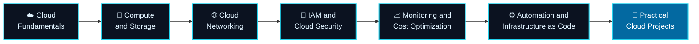

<!--
=====================================================================
SETUP NOTE (delete this comment block before publishing)
=====================================================================
1. Create a PUBLIC repository whose name EXACTLY matches your GitHub
   username (e.g. username "amit123" -> repository "amit123").
   Tick "Add a README file" when creating it.
2. Replace this repository's README.md with this file.
3. Use Find & Replace for these placeholders:
      YOUR-USERNAME            -> your GitHub username
      YOUR-LINKEDIN-USERNAME   -> your LinkedIn profile slug
      https://YOUR-PORTFOLIO-URL.example -> your site (or delete the badge)
4. Fill in every "[EDIT ...]" marker and the project placeholders.
5. Commit to the default branch. The profile README appears on
   https://github.com/YOUR-USERNAME
=====================================================================
-->

<!-- ============================ HEADER ============================ -->

 

---

## 👋 About Me

I'm **Amit**, a cloud computing enthusiast who learns by building. I'm focused on understanding how modern cloud infrastructure works and turning that knowledge into hands-on, practical projects.

**What I'm interested in**

- ☁️ Cloud computing and cloud infrastructure
- 🟠 Amazon Web Services (AWS)
- 🌐 Cloud networking and storage
- 🔐 Cloud security and identity management
- 📈 Monitoring, automation, and cost optimization
- 🛠️ Hands-on learning through technical projects

**Currently**

- 🔭 Learning: `[EDIT: e.g. AWS networking fundamentals]`
- 🌱 Building: `[EDIT: current project or lab]`
- 📍 Location / timezone: `[EDIT or delete]`
- 💬 Ask me about: `[EDIT: topics you are comfortable discussing]`

---

## 🧰 Technology Stack

> **Honesty note:** Items are grouped by *how I actually use them*. Move a technology up to "Hands-on" only once a repository demonstrates it.

### ☁️ Cloud Platforms

| Platform | Status |
|---|---|
| Amazon Web Services | 🟠 Primary focus — `[EDIT: Learning / Hands-on]` |
| Microsoft Azure | 🔵 Exploring |
| Google Cloud Platform | 🔵 Exploring |

### 💻 Development and Operating Systems

| Technology | Status |
|---|---|
| Linux, Bash | `[EDIT: Learning / Hands-on]` |
| Git, GitHub | `[EDIT: Learning / Hands-on]` |
| Python | `[EDIT: Learning / Hands-on]` |
| HTML5, CSS3, JavaScript | `[EDIT: Learning / Hands-on]` |

### 🧠 Cloud Concepts

| Concept | Status |
|---|---|
| EC2, S3, IAM, VPC | `[EDIT: Learning / Hands-on]` |
| Subnets and routing | `[EDIT: Learning / Hands-on]` |
| Cloud monitoring | `[EDIT: Learning / Hands-on]` |
| Infrastructure as Code | 🌱 Learning |
| Docker fundamentals | 🌱 Learning |
| Cloud security | `[EDIT: Learning / Hands-on]` |

---

## 🗺️ Cloud Learning Roadmap

### ✅ Progress Checklist

Tick items as you complete them (`[x]`).

- [ ] Cloud Fundamentals — shared responsibility, regions, availability zones
- [ ] Compute and Storage — EC2, S3, EBS
- [ ] Cloud Networking — VPC, subnets, route tables, security groups
- [ ] IAM and Cloud Security — users, roles, policies, MFA
- [ ] Monitoring and Cost Optimization — CloudWatch, budgets, billing alerts
- [ ] Automation and Infrastructure as Code
- [ ] Practical Cloud Projects — build, document, and publish

---

## 🚀 Projects Showcase

📂 **[Browse all my repositories →](https://github.com/YOUR-USERNAME?tab=repositories)**

> 📌 **Reminder:** Pin your strongest three to six repositories on your profile (*Customize your pins*) so they appear right below this README.

> Replace each placeholder below with a real project. Only list a project as **Complete** if it is finished.

| # | Project | Description | Tech Stack | Status | Link |
|---|---|---|---|---|---|
| 1 | `[EDIT: Project name]` | `[EDIT: one-line description]` | `[EDIT]` | `[Planned / In progress / Complete]` | [Repo](https://github.com/YOUR-USERNAME/YOUR-REPOSITORY-1) |
| 2 | `[EDIT: Project name]` | `[EDIT: one-line description]` | `[EDIT]` | `[Planned / In progress / Complete]` | [Repo](https://github.com/YOUR-USERNAME/YOUR-REPOSITORY-2) |
| 3 | `[EDIT: Project name]` | `[EDIT: one-line description]` | `[EDIT]` | `[Planned / In progress / Complete]` | [Repo](https://github.com/YOUR-USERNAME/YOUR-REPOSITORY-3) |
| 4 | *(optional)* | | | | |
| 5 | *(optional)* | | | | |
| 6 | *(optional)* | | | | |

---

## 📊 GitHub Analytics

 

 

 

ℹ️ These graphics are generated live by third-party services. They may be temporarily unavailable, slow, or rate-limited, and they only reflect public GitHub activity. Nothing here is manually edited.

---

## 🔐 Cloud Security Principles

| Principle | What it means in practice |
|---|---|
| 🔑 **Least-privilege access** | Grant only the permissions a user, role, or service needs — nothing more |
| 🪪 **Secure identity and access management** | Use MFA, roles over long-lived users, and regular permission reviews |
| 🗝️ **Secret and credential protection** | Never commit keys or tokens; use secret managers and environment variables |
| 🌐 **Secure network configuration** | Restrictive security groups, private subnets, and minimal open ports |
| 📜 **Monitoring and logging** | Enable audit logs and alerts to detect unusual activity early |
| 💰 **Cost awareness** | Set budgets and billing alerts, tag resources, and clean up unused ones |

---

## 🌍 Connect With Me

  

**⭐ Learn • Build • Deploy • Secure ⭐**

